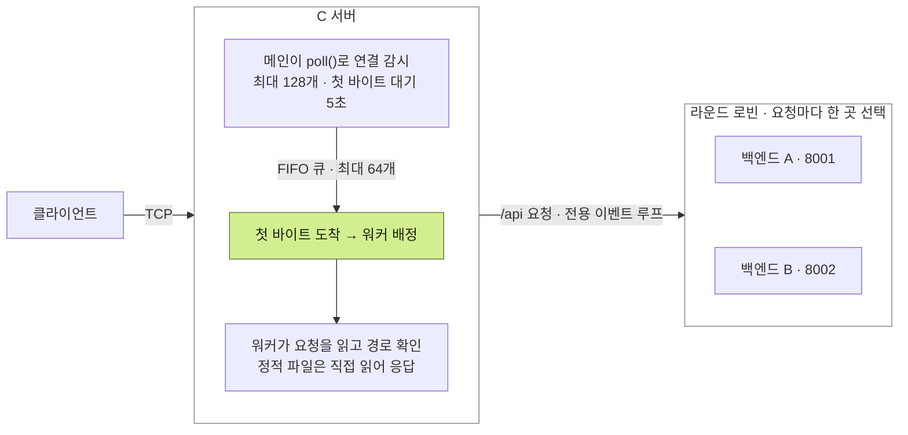

# C 웹 서버 + Reverse Proxy

> C와 POSIX 소켓 API로 웹 서버를 만들고 `/api` 요청을 백엔드로 나눠 보내는 리버스 프록시 구현

---

## 1. 흐름도

**요청 하나가 거치는 세 단계**

1. 메인 스레드가 연결을 수락하고, 첫 바이트가 오면 소켓 정보를 작업 큐에 등록
2. 워커가 요청을 읽고 HTTP로 파싱
3. 경로에 따라 `/api` 요청은 백엔드 A·B에 번갈아 전달, 나머지는 문서 루트의 파일을 직접 읽어 응답

---

## 2. 구현 방식

트레이드오프가 있거나 고민할 가치가 있는 문제는 **[decisions.md](decisions.md)** 에 선택지와 대안으로 정리

<b>decisions 정리</b>

| ID | 결정할 문제 | 최종 선택 | 선택 이유 |
| --- | --- | --- | --- |
| **D01** | **동시 처리 모델** | **`poll()`로 읽기 가능 확인 후 스레드 풀에 배정** | **요청이 시작되지 않은 연결을 워커 밖에서 관리** |
| D02 | 감시 목록·작업 큐 상한 | 감시 128개 · FIFO 큐 64개 · 워커 4개 | 처리 자원과 대기 소켓 수를 예측 가능 |
| D03 | 연결·작업 수 초과 | 감시 목록 포화 시 연결 종료 · 작업 큐 포화 시 `503` 시도 후 종료 | 메인이 응답을 보내느라 기다리지 않음. 요청이 도착한 연결에만 `503`으로 거절 이유 전달 |
| D04 | 연결·요청 타임아웃 | 첫 바이트 대기 5초 · 워커 I/O 무응답 30초 | 요청 시작 전 연결은 빨리 회수, 처리 중인 느린 요청은 넉넉히 대기. 30초 안에 조금씩 보내는 연결은 계속 워커를 점유함 |
| D05 | Keep-Alive | 다음 요청 대기 5초 · 연결당 최대 100개 | 연결을 재사용하면서 유휴 상태와 연속 요청 양쪽의 워커 점유 제한 |
| D06 | 서버 종료 | 연결 즉시 중단 후 자원과 워커 회수 | 느린 클라이언트나 백엔드 때문에 종료가 지연되지 않음 |
| D07 | POST 본문 보관 | 최대 1MiB까지 전부 수신한 뒤 처리 | 본문 메모리에 상한을 두고 라우팅과 프록시 흐름을 단순하게 유지 |
| D08 | 요청 본문 경계 | `Content-Length`로 판별 · POST에서 누락 시 `411` | 지원 범위를 명확히 하고 본문의 끝을 판별 가능 |
| D09 | 정적 파일 제공 | C 서버가 문서 루트 안에서 직접 제공 | 파일 접근과 MIME, 오류 처리를 한 서버에서 제어 |
| D10 | 정적 파일 전송 | 16KiB씩 `read()`와 `send()` 반복 | 작은 고정 버퍼와 공통 POSIX API로 큰 파일도 전송 |
| D11 | 정적 요청과 API 구분 | 기본 `/api`와 `/api/*`를 프록시로 전달 | 같은 호스트에서 URL 경로만으로 두 흐름을 구분 |
| D12 | 프록시 응답 본문 | 헤더 검증 후 16KiB 버퍼로 스트리밍 | 큰 본문을 통째로 저장하지 않고 받은 부분부터 전송 |
| D13 | 백엔드 분산 방식 | A·B에 Round-Robin으로 순차 분산 | 백엔드 상태를 측정하지 않고 순서만으로 고르게 분산. 한 백엔드가 실패해도 다음 요청은 다음 백엔드로 감 |

가장 많이 고민한 부분은 동시 요청을 처리할 때 **워커가 기다리는 시간**을 줄이는 일

### ① 스레드 풀에서 첫 바이트가 오면 워커 배정 · [D01](decisions.md#d01-동시-요청-처리-모델)

| &nbsp;&nbsp;&nbsp;&nbsp;&nbsp;&nbsp;&nbsp;구&#8288;분&nbsp;&nbsp;&nbsp;&nbsp;&nbsp;&nbsp;&nbsp; | 내용 |
| --- | --- |
| **이유** | 기본적인 스레드 풀은 연결이 들어오는 즉시 워커를 배정 → 연결만 하고 요청을 보내지 않는 클라이언트 4개가 워커 4개를 모두 점유할 수 있음 |
| **방식** | 메인에 첫 바이트를 기다리는 연결의 대기 리스트를 두고 `poll()`로 감시(최대 128개 · 5초). 첫 바이트가 오면 작업 큐에 넣어 워커에 넘기도록 |
| **한계** | 워커 배정 후의 대기는 그대로 남음. 특히 `/api` 요청은 **백엔드 응답을 기다리는 시간**이 길고, 그동안 워커 하나를 계속 점유 |

### ② 워커 대신 이벤트 루프가 백엔드 처리

| &nbsp;&nbsp;&nbsp;&nbsp;&nbsp;&nbsp;&nbsp;구&#8288;분&nbsp;&nbsp;&nbsp;&nbsp;&nbsp;&nbsp;&nbsp; | 내용 |
| --- | --- |
| **이유** | 테스트 시 API 요청이 워커 수만큼만 들어와도, 백엔드 응답을 2초씩 기다리느라 워커가 모두 묶이고 정적 파일 요청까지 지연 |
| **방식** | 정적 파일은 워커가 처리하지만, 백엔드로 가는 /api 요청만 파싱 후 이벤트 루프에 넘김. 백엔드 연결부터 응답 전달까지 루프가 맡고, 워커는 바로 다음 요청을 처리 |
| **한계** | 요청 수신과 정적 파일 전송은 여전히 워커가 담당하기 때문에 느린 클라이언트는 워커를 붙잡을 수 있음 |

---

## 3. 검증

| &nbsp;&nbsp;&nbsp;&nbsp;&nbsp;&nbsp;&nbsp;구&#8288;분&nbsp;&nbsp;&nbsp;&nbsp;&nbsp;&nbsp;&nbsp; | 방법 | 결과 |
| --- | --- | --- |
| **단위 테스트** | HTTP 파서 · MIME 매핑 · 라우팅 · 프록시 응답 처리 · 스레드 풀을 모듈별로 C 테스트 | 5개 모듈 통과 |
| **기능 테스트** | 서버와 백엔드 A·B를 실제로 띄운 통합 테스트 20개 · 브라우저 데모 페이지 | 정적 파일 · POST · Round-Robin 정상 |
| **동시 접속** | 요청을 보내지 않는 연결 4개(워커 수와 같음)를 열어 둔 채 새 요청 | `200` · 요청 없는 연결은 5초 뒤 서버가 끊음 |
| | 백엔드 응답에 2초 걸리는 API 요청 8개를 보내 둔 채 정적 파일 요청 | 0.01초 안에 `200` |
| **부하 테스트** | `ab` 동시 1 · 64 · 96개, 조합별 3,000건 | 동시 96개에서 초당 약 11,000건 · 실패 0% |
| **메모리 검사** | 같은 테스트를 ASan·UBSan 빌드로 실행 · macOS `leaks` · ThreadSanitizer | 누수 0건 · 잘못된 접근 0건 · 경합 0건 |

**엣지 케이스**

| &nbsp;&nbsp;&nbsp;&nbsp;&nbsp;&nbsp;&nbsp;구&#8288;분&nbsp;&nbsp;&nbsp;&nbsp;&nbsp;&nbsp;&nbsp; | 예 | 응답 |
| --- | --- | --- |
| **잘못된 요청** | `Host` 없음 · `:` 없는 헤더 줄 · 메서드 `G@T` · 버전 `HTTP/1.x` | `400` |
| **불완전한 요청** | 헤더나 본문이 끝나기 전에 멈춤 | `408` |
| **지원하지 않는 요청** | `HTTP/2.0` · `Transfer-Encoding: chunked` · 길이 없는 POST | `505` · `501` · `411` |
| **너무 큰 요청** | 본문 1MiB 초과 · 긴 URI · 큰 헤더 | `413` · `414` · `431` |
| **백엔드 문제** | 연결 거부 · 응답 없음 · 백엔드 없음 | `502` · `504` · `503` |
| **갑작스러운 연결 종료** | 4MiB 파일을 받던 클라이언트가 강제 종료 | 다음 요청 정상 처리 |
| **파일 한도 초과** | 파일 한도 48에서 연결 96개 | 서버 유지 · 연결이 줄면 다시 응답 |

**한계** — 연결 1만 개 실험에서 새 요청 응답이 2.56초 지연. 매번 전체를 훑는 `poll()` 때문으로 보임 → `epoll` / `kqueue`가 다음 과제

<b>테스트 명령</b>

| &nbsp;&nbsp;&nbsp;&nbsp;&nbsp;&nbsp;&nbsp;구&#8288;분&nbsp;&nbsp;&nbsp;&nbsp;&nbsp;&nbsp;&nbsp; | 명령 |
| --- | --- |
| **단위 테스트** | `make test` |
| **통합 테스트** | `make integration-test` |
| **메모리 검사** | `make sanitize-test sanitize-integration-test` |

---
