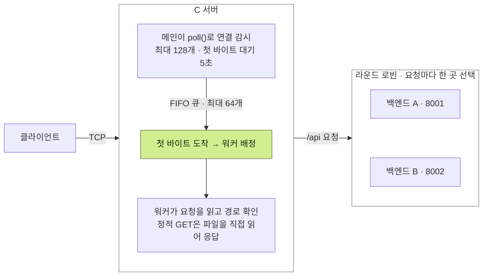

# C 웹 서버 + Reverse Proxy

> C와 POSIX 소켓 API만으로 만든 **정적 파일 서빙**과 **`/api` 요청을 백엔드로 나눠 보내는 리버스 프록시**

---

## 1. 흐름도

**요청 하나가 거치는 세 단계**

1. **메인 스레드**가 연결을 받아 작업 큐에 넣음
2. **워커 네 개 중 하나**가 요청을 읽고 HTTP로 파싱
3. 경로를 보고 **`/api` 요청은 백엔드 A·B에 번갈아** 전달, 나머지는 **문서 루트의 파일**을 직접 읽어 전송

---

## 2. 구현 방식

트레이드오프가 있거나 고민할 가치가 있는 문제는 **[decisions.md](decisions.md)** 에 선택지와 대안으로 정리

<b>decisions</b>

| ID | 결정할 문제 | 최종 선택 | 선택 이유 |
| --- | --- | --- | --- |
| **D01** | **동시 처리 모델** | **`poll()`로 읽기 가능 확인 후 스레드 풀에 배정** | **요청이 시작되지 않은 연결을 워커 밖에서 관리** |
| D02 | 감시 목록·작업 큐 상한 | 감시 128개 · FIFO 큐 64개 · 워커 4개 | 처리 자원과 대기 소켓 수를 예측 가능 |
| D03 | 연결·작업 수 초과 | 감시 목록 포화 시 연결 종료 · 작업 큐 포화 시 `503` 시도 후 종료 | 메인이 응답을 보내느라 기다리지 않음. 요청이 도착한 연결에만 `503`으로 거절 이유 전달 |
| D04 | 연결·요청 타임아웃 | 첫 바이트 대기 5초 · 워커 I/O 무응답 30초 | 요청 시작 전 연결은 빨리 회수, 처리 중인 느린 요청은 넉넉히 대기. 30초 안에 조금씩 보내는 연결은 계속 워커를 점유함 |
| D05 | Keep-Alive | 다음 요청 대기 5초 · 연결당 최대 100개 | 연결을 재사용하면서 유휴 상태와 연속 요청 양쪽의 워커 점유 제한 |
| D06 | 서버 종료 | 연결 즉시 중단 후 자원과 워커 회수 | 느린 클라이언트나 백엔드 때문에 종료가 지연되지 않음 |
| D07 | POST 본문 보관 | 최대 1MiB까지 전부 수신한 뒤 처리 | 본문 메모리에 상한을 두고 라우팅과 프록시 흐름을 단순하게 유지 |
| D08 | 요청 본문 경계 | `Content-Length`로 판별 · POST에서 누락 시 `411` | 지원 범위를 명확히 하고 본문의 끝을 판별 가능 |
| D09 | 정적 파일 제공 | C 서버가 문서 루트 안에서 직접 제공 | 파일 접근과 MIME, 오류 처리를 한 서버에서 제어 |
| D10 | 정적 파일 전송 | 16KiB씩 `read()`와 `send()` 반복 | 작은 고정 버퍼와 공통 POSIX API로 큰 파일도 전송 |
| D11 | 정적 요청과 API 구분 | 기본 `/api`와 `/api/*`를 프록시로 전달 | 같은 호스트에서 URL 경로만으로 두 흐름을 구분 |
| D12 | 프록시 응답 본문 | 헤더 검증 후 16KiB 버퍼로 스트리밍 | 큰 본문을 통째로 저장하지 않고 받은 부분부터 전송 |
| D13 | 백엔드 분산 방식 | A·B에 Round-Robin으로 순차 분산 | 백엔드 상태를 측정하지 않고 순서만으로 고르게 분산. 한 백엔드가 실패해도 다음 요청은 다음 백엔드로 감 |

그중 C10K를 생각하며 가장 고민한 부분: **메인이 받은 연결을 워커에 넘기는 시점** · [D01](decisions.md#d01-동시-요청-처리-모델)

| 흐름 | 내용 |
| --- | --- |
| **처음 생각** | 스레드 풀로 **연결과 동시에** 워커 배정 |
| **문제** | 아무것도 보내지 않는 클라이언트 **4개만으로 워커 4개가 모두 묶임** |
| **다른 선택지** | 헤더를 다 받은 뒤 넘기는 방식 → 메인이 연결마다 어디까지 받았는지 기억하고, 헤더 끝을 찾는 처리를 또 해야 함 |
| **선택** | 그 중간인 **첫 바이트** |
| **방식** | 연결만 온 경우는 메인이 **감시 목록**에 두고 (최대 128개 · 5초), 요청의 **첫 바이트가 오면** 워커에 넘김 |
| **한계** | **한 글자만 보내고 멈추는 연결**, **백엔드를 기다리는 동안**은 워커가 여전히 묶임 |

---

## 3. 검증

- **기능 테스트** — 서버와 백엔드를 실제로 띄워서 **18개 시나리오** 실행
  - 아무것도 안 보내는 연결 4개가 열려 있어도 → **다섯 번째 요청은 `200`**
  - 말없는 연결은 → **5초에 끊김**
- **메모리** — sanitizer와 leaks로 검사 → **누수 0건**
- **부하 테스트** — 동시 64개까지 **모든 요청 성공**
  - 96개에서는 **프록시 요청의 85%가 `503`** → 워커가 **백엔드를 기다리느라 묶였기 때문**
  - 백엔드로 요청을 보내고 기다리는 부분을 **별개의 흐름으로 나눠 보완할 계획**

### 부하 테스트 결과

Apache Bench · macOS 루프백 · 조합별 3,000건 · 요청마다 새 연결

| 동시 요청 | 정적: 요청/초 · p95 · 비 2xx | 프록시: 요청/초 · p95 · 비 2xx |
| ---: | ---: | ---: |
| 1 | 9,715 · <1ms · 0% | 3,707 · <1ms · 0% |
| 64 | 29,249 · 2ms · 0% | 6,792 · 10ms · 0% |
| 96 | 33,871 · 3ms · **0%** | 29,597 · 17ms · **85.1%** |

- **비 2xx** = 성공(`200`대)이 아닌 응답 비율. 여기서는 큐가 가득 차서 돌려보낸 `503`
- 같은 동시 96개에서 **정적은 0%, 프록시만 85%** → 백엔드를 기다리는 동안 워커가 묶인다는 근거

테스트 명령

| 종류 | 명령 |
| --- | --- |
| 단위 테스트 (HTTP 파서, 라우터, 스레드 풀 등) | `make test` |
| 통합 테스트 (서버 + 백엔드 A·B 실제 실행, 18개 시나리오) | `make integration-test` |
| 메모리 검사 (같은 테스트를 ASan·UBSan 빌드로) | `make sanitize-test sanitize-integration-test` |

---
